# MediaCC

**A card catalog for your media.** MediaCC is a private, offline video library for Windows. Catalog the video files you already own, find any of them in seconds, and play them with bookmarks, all on your own computer. No account, no cloud, no tracking.

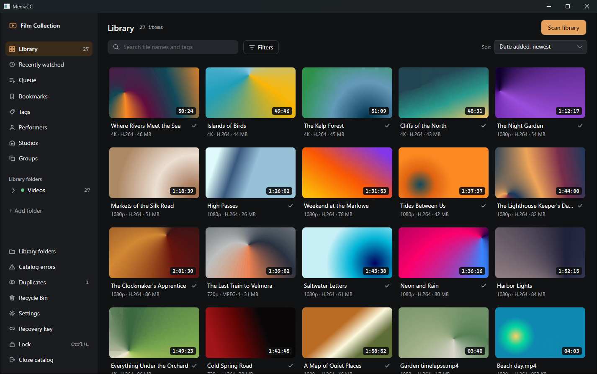

## Why MediaCC

- **Private by design.** Each catalog is encrypted with a password you choose. Nothing about your library leaves your computer unless you turn on online lookups yourself.
- **Your files stay as they are.** MediaCC reads your videos. It never moves, renames or edits them.
- **It remembers the video, not the path.** Every file is recognized by its content, so titles, tags and bookmarks survive renames, moves and new drive letters.
- **Portable.** One zip, no installer. Run it from any folder or a USB drive, and it leaves nothing behind on the PC.

## Features

### A library that stays organized

- **You choose the folders.** MediaCC only scans folders you add. It never searches your drives, and it has no default folders.
- **Background scanning** with progress and Cancel. Rescanning files that haven't changed is quick, and nothing is ever added twice.
- **Thumbnails and hover previews** are made automatically. Rest the pointer on a card to skim through the video.
- **Browse by folder** with a folder tree and breadcrumbs, or browse by what's in your videos instead.
- **External drives are fine.** Unplug a drive and its videos keep everything you've added to them. Plug it back in under another letter and the app offers to reconnect it.

### Rich, structured details

- **Titles, descriptions, release dates and ratings** from half a star to five, plus an **Organized** checkbox to track your progress.
- **Hierarchical tags.** Put *Nature* under *Documentary* under *Genre*, and filtering by *Documentary* finds them all. Tags can have aliases and more than one parent.
- **Performers.** A page for everyone who appears in your videos, with a portrait, aliases, biography, rating, favorites and statistics such as total watch time.
- **Studios** in a tree, so a label sits under its parent company, each with a logo and item counts.
- **Groups** for series, trilogies and collections, with cover art and part numbers.
- **Web links** for each video, tidied so the same page is never stored twice.
- **Bulk editing.** Select any number of videos and set tags, performers, studio, groups or rating for all of them at once.

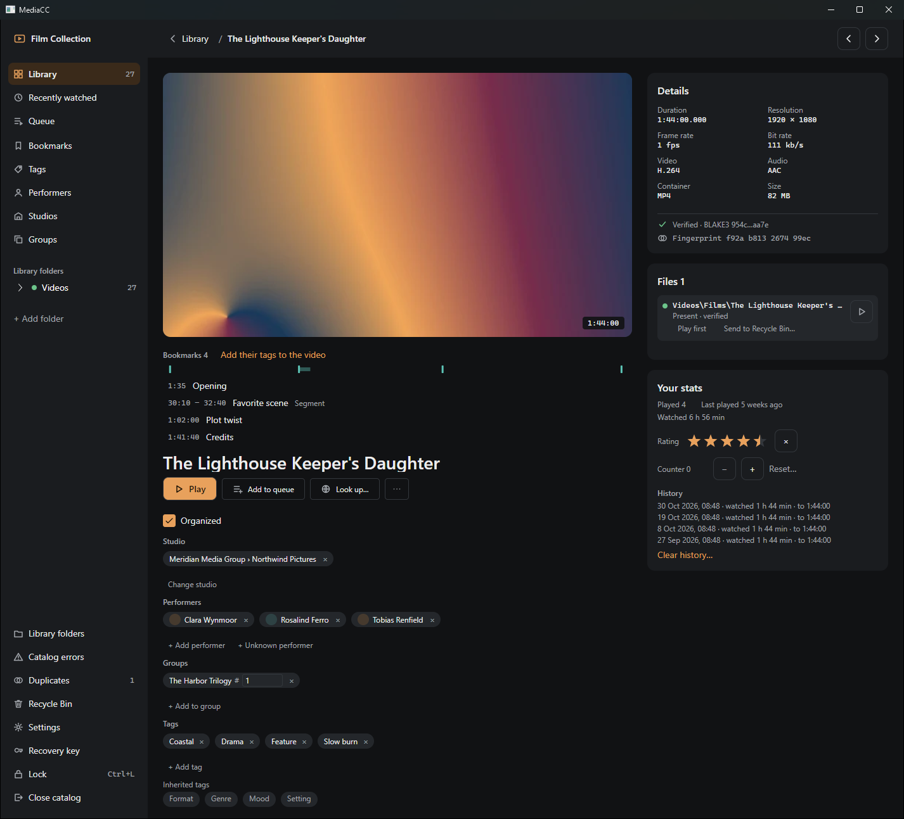

### Find anything

- **Search as you type** across titles, descriptions, file names and tags.
- **A filter pane** of collapsible sections: tags (all of, any of, none of, with child tags), performers, studio and release date, rating and plays, video quality and housekeeping.
- **Sort** by date added, name, release date, rating, duration, size, resolution, play count or last played.
- **Saved searches** keep your favorite filters a click away in the sidebar.

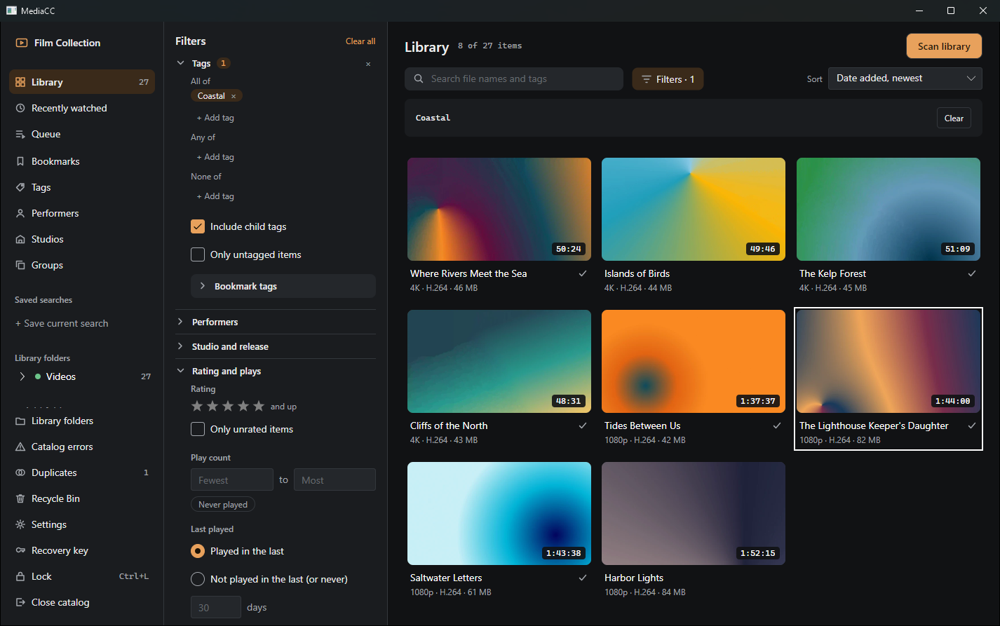

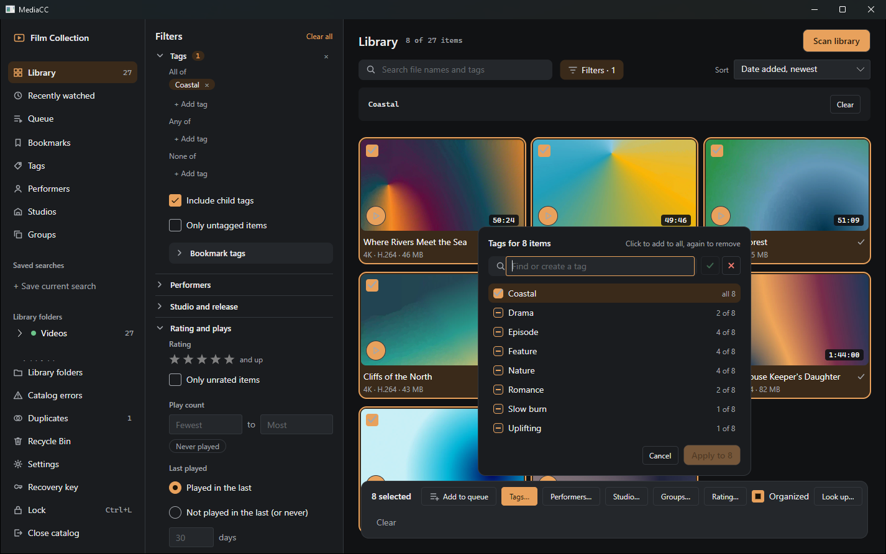

### A player built for collections

- **Smooth playback** of all common formats, with frame-by-frame stepping, speeds from 0.25× to 4×, a seek bar that previews frames, and full screen.
- **Bookmarks.** Mark a moment or a whole segment, give it a tag, and jump straight back to it later. Loop a segment or stop at its end.
- **A bookmark wall** of every bookmark in your library, filtered by tag or performer, ready to play one after another.
- **A play queue** of videos and bookmarks, with Next and Previous.
- **Pick up where you left off**, with play counts, watch time and a **Recently watched** page.
- **Keyboard shortcuts** for everything, with an overlay that lists them.

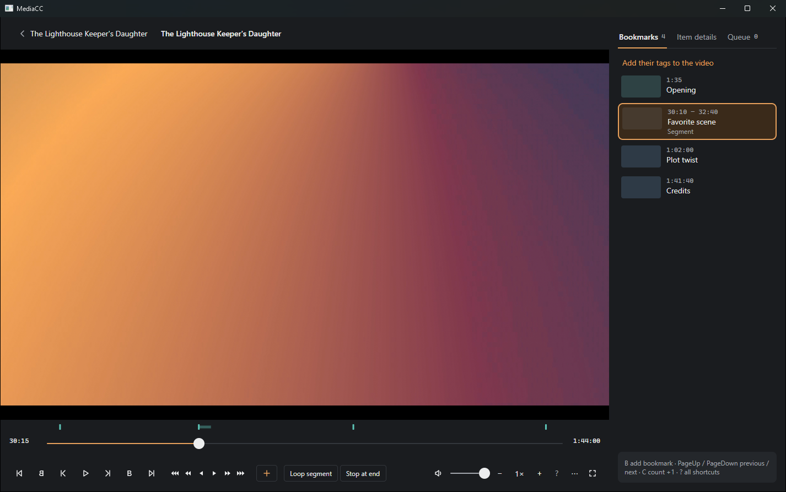

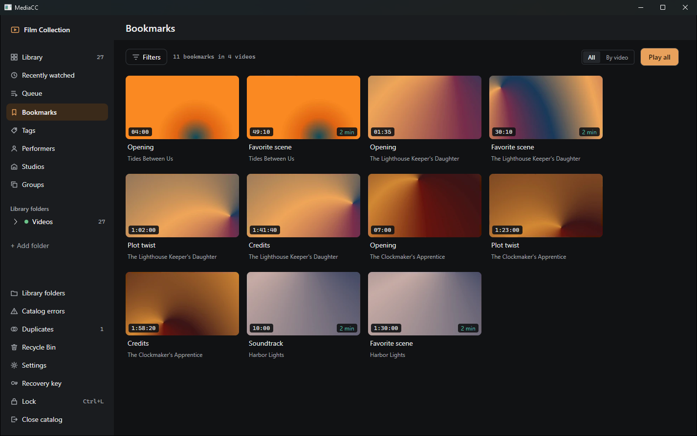

### Keep your library tidy

- **Duplicates.** Exact copies are found by their content. Near-duplicates, such as the same video at another resolution, are found by a visual fingerprint, at a sensitivity you choose.
- **Merge without losing anything.** Merging keeps every tag, bookmark and play count, and keeps the other file as an alternative version.
- **Re-encoded or replaced files.** When a video goes missing and a similar one appears, the app offers to move everything over, retiming the bookmarks for the new file.
- **Verify library** re-reads your files and flags any whose content has changed since they were added, for example after disk errors.
- **Recycle Bin, never delete.** The only thing MediaCC ever does to a file is send it to the Windows Recycle Bin, and only when you ask and confirm. A Recycle Bin page lets you restore it.

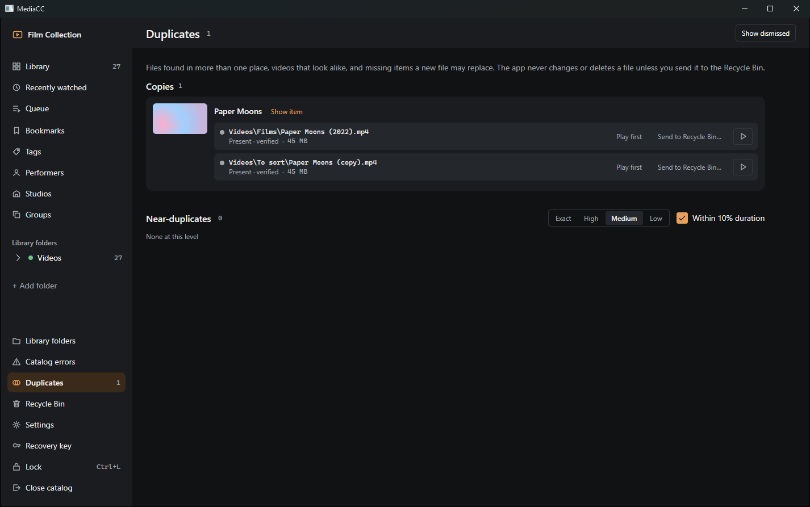

### Optional online lookups

Online lookups are off in every new catalog. When you turn them on, you choose the sources and add your own API keys, and you see exactly what will be sent before anything is sent. A lookup can fill in titles, dates, studios, performers and tags, and **nothing is applied until you review it** side by side with what you already have. A URL scraper reads details from web pages you point it at, using rule files you import. Lookups can go through an HTTP or SOCKS5 proxy, and never bypass it.

## Privacy and security

| | |
|---|---|
| **Encryption** | An encrypted catalog's database, thumbnails, previews and images are encrypted at rest with ChaCha20-Poly1305. Decrypted data is never written to temporary files. |
| **Recovery key** | Creating an encrypted catalog gives you a recovery key, so a forgotten password doesn't mean a lost catalog. |
| **Lock** | Press Ctrl+L to lock the catalog. It closes, and your password brings it back. |
| **No telemetry** | No analytics, crash reports, update checks or remote fonts. The app makes no network connections unless you turn on online lookups. |
| **Discreet logs** | The app's log never contains titles, file names, paths, tags, names or searches. |
| **Your choice** | On a computer only you use, you can create an unencrypted catalog instead, with an optional lock password. |

Keep as many catalogs as you like, wherever you like: on an external drive, next to your videos, or on a USB stick with the app.

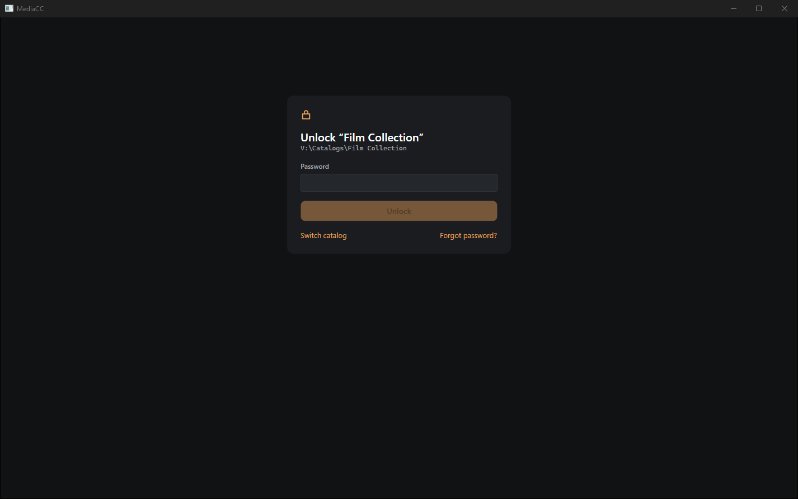

## More screenshots

| | |
|---|---|
| 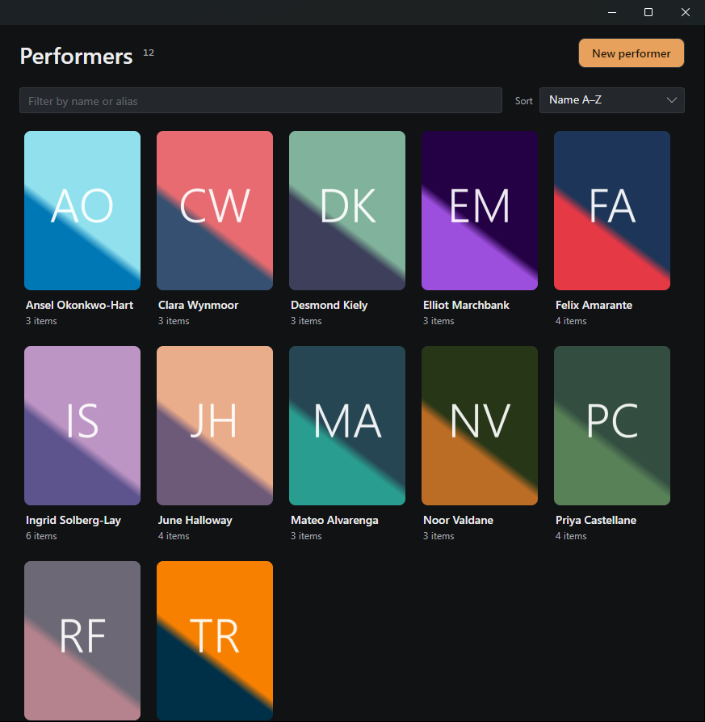 | 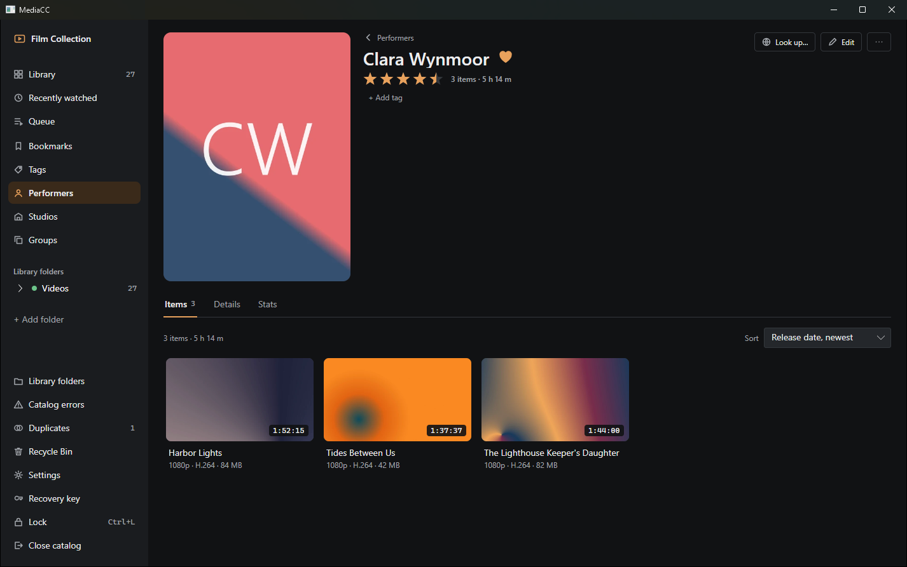 |
| 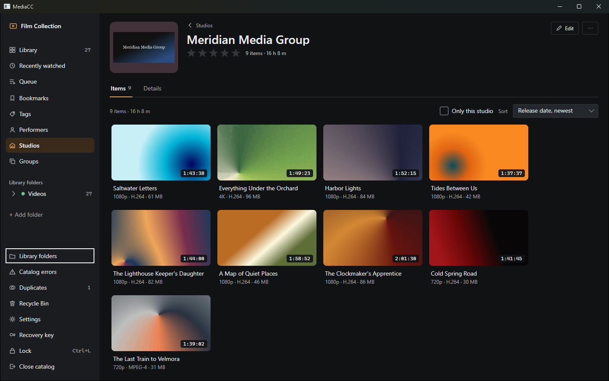 | 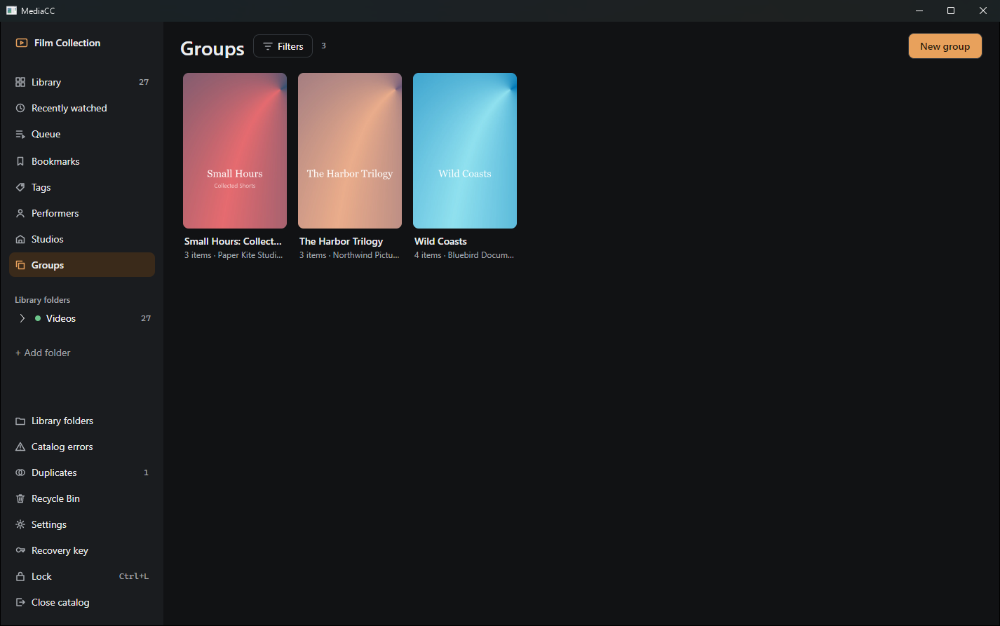 |
| 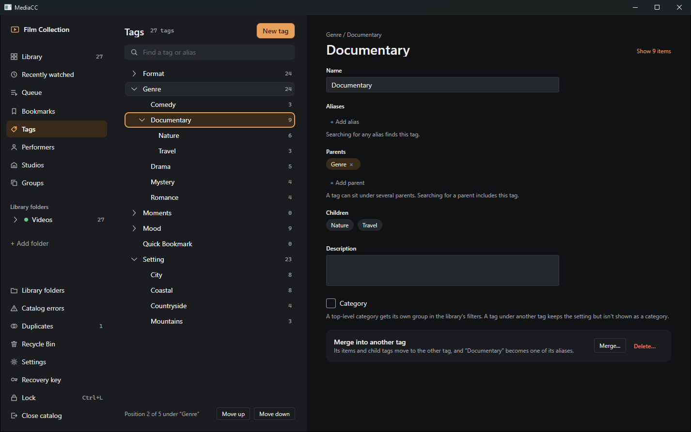 | 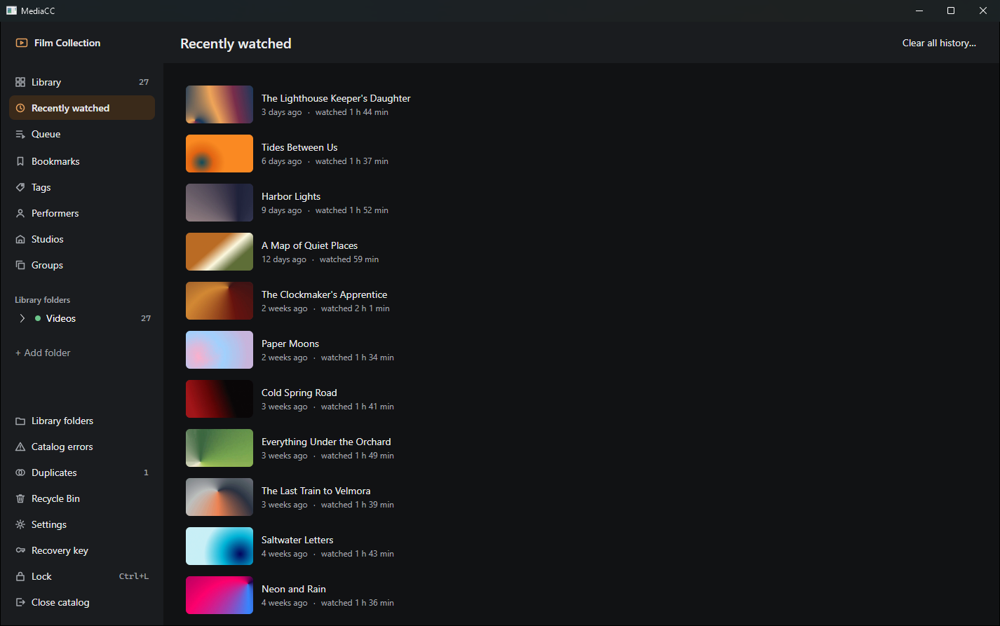 |

## Requirements

- Windows 10 or 11, 64-bit.
- Nothing else to install: .NET, the video player and FFmpeg are in the zip.

## Getting started

1. Extract the zip to a folder you can write to, such as `Documents\MediaCC` or a USB drive. Don't run it from inside the zip.
2. Run the app from that folder. The app isn't signed yet, so Windows SmartScreen may ask first: choose **More info**, then **Run anyway**.
3. **Create a catalog**: choose where it lives and set a password. Write down the recovery key, or save it somewhere safe.
4. **Add a folder** of videos and let the scan run. Thumbnails and previews fill in as it goes.

## On the roadmap

- Opening the player and other pages in windows of their own.
- Discretion features: a panic hotkey, locking with your Windows session, hiding the app from screen capture, and a neutral window title and icon.
- Encrypted export and import of a catalog.
- A browser extension that saves online videos to your catalog.

## Credits

MediaCC plays video with [libmpv](https://mpv.io) and reads media details with [FFmpeg](https://ffmpeg.org), both under the LGPL. Every download includes the full third-party notices in `THIRD-PARTY-NOTICES.txt`.

*The screenshots show a demo catalog. Every title, name, studio and image in them is made up, and the videos are generated color gradients.*
